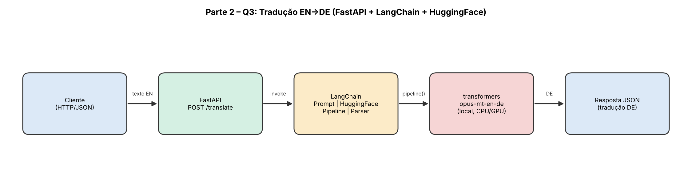

# Parte 2 – Questão 3: Tradução EN → DE com HuggingFace via LangChain (FastAPI)

API que traduz textos do inglês para o alemão usando o modelo **Helsinki-NLP/opus-mt-en-de**, com o LangChain (`HuggingFacePipeline`) gerenciando as chamadas ao modelo.

## Estrutura

```
parte2-q3-langchain-hf-traducao-en-de/
├── app/
│   ├── __init__.py
│   ├── main.py        # aplicação FastAPI + carga da cadeia no lifespan
│   ├── schemas.py
│   └── translator.py  # cadeia LCEL: Prompt | HuggingFacePipeline | StrOutputParser
├── docs/
│   └── arquitetura.png
├── tests/
│   └── test_api.py    # testes com stub (não baixam o modelo)
├── pytest.ini
├── requirements.txt
└── README.md
```

## Como executar

```bash
python -m venv .venv
source .venv/bin/activate        # Windows: .venv\Scripts\activate
pip install -r requirements.txt
uvicorn app.main:app --reload
```

O modelo (~300 MB) é baixado na primeira execução. Documentação interativa: http://127.0.0.1:8000/docs

## Exemplo de uso

```bash
curl -X POST http://127.0.0.1:8000/translate \
  -H "Content-Type: application/json" \
  -d '{"text": "The weather is nice today."}'
```

```json
{
  "original_text": "The weather is nice today.",
  "translated_text": "Das Wetter ist heute schön.",
  "source_language": "en",
  "target_language": "de",
  "model": "Helsinki-NLP/opus-mt-en-de"
}
```

## Arquitetura



Fluxo: Cliente → FastAPI → cadeia LangChain (Prompt → HuggingFacePipeline → Parser) → `transformers` (`opus-mt-en-de`, local) → resposta JSON.

## Testes

```bash
pytest -q
```
